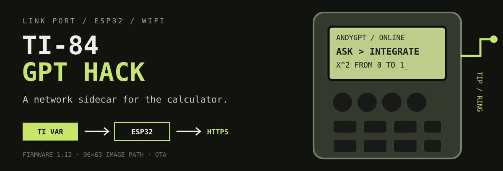

<p align="center">
  
</p>

<p align="center">
  <strong>A graphing calculator with a network sidecar.</strong><br>
  An ESP32 speaks the TI link protocol, makes web requests, and sends text, programs, and 96×63 images back as calculator variables.
</p>

<p align="center">
  <a href="./demo.mp4">Watch the repository demo</a>
</p>

<p align="center">
  
</p>

> This is a hardware and protocol research project—not an exam aid. Follow your school’s device and academic-integrity rules.

## What it can do

- Ask an OpenAI-compatible model questions with persistent chat sessions
- Page long text responses on the calculator screen
- Connect through a phone-friendly captive portal, including WPA2-Enterprise networks
- Scan and select nearby Wi-Fi networks from the calculator
- Download calculator programs and 96×63 monochrome images
- Update both ESP32 firmware and the calculator launcher over the air
- Serve a built-in AP Physics C E&M reference without a network request
- Run GPT-backed physics and math prompts
- Expose a Telnet serial monitor over the local network
- Sleep after two minutes of inactivity and wake when the calculator sends a command

## The link-port trick

```text
TI-BASIC launcher
       │ command + arguments as TI variables
       ▼
TI-84 link port ── TIP / RING ── ESP32
                                      │
                         Wi-Fi / HTTPS / OTA
                                      │
                                      ▼
                    GPT API · firmware · programs
```

The ESP32 uses `CBL2`, `TICL`, and `TIVar` to behave like another calculator. The launcher sends a command ID and arguments; firmware performs the network or local operation, then returns a TI string, number, picture, or program. The calculator never needs to understand HTTP.

## Project layers

| Layer | Responsibility |
| --- | --- |
| `programs/ANDYGPT.8xp` | calculator menus and interaction |
| `esp32/esp32.ino` | link protocol, Wi-Fi, commands, sleep, and OTA |
| `server/` | GPT, program, image, firmware, log, and request routes |
| `pcb/` | KiCad board, schematic, Gerbers, and build photos |
| `compile_launcher.py` + scripts | prepare launcher and firmware assets |

## Use the existing build

The firmware currently points to `https://api.andypandy.org`.

1. Run **ANDYGPT** on the calculator.
2. Open **Settings → SETUP**.
3. Join the temporary Wi-Fi network named `calc` from a phone or computer.
4. Use the captive portal—or open `192.168.4.1`—to save network credentials.
5. Return to the launcher and choose a connected feature.

The ESP32 stores Wi-Fi credentials for later boots. For mixed-case input on the TI-84 keyboard, letters are lowercase by default and parentheses mark uppercase letters: `(H)ELLO` becomes `Hello`.

## Build your own hardware

The KiCad sources, schematic, Gerbers, firmware, and calculator programs are included. A detailed assembly tutorial is intentionally out of scope: this build involves a custom PCB, fine-pitch hardware work, and a timing-sensitive calculator bus. It is not a first soldering project.

At the software level:

1. Open `esp32/esp32.ino` in Arduino IDE.
2. Install the ESP32 board support and the libraries included by the sketch: `TICL`, `CBL2`, `TIVar`, and `UrlEncode`.
3. Flash the firmware to the ESP32 target used by your board.
4. Transfer `programs/ANDYGPT.8xp` to the TI-84, or use the launcher update path once the bridge is working.

If you change hardware, verify the `TIP` and `RING` pin definitions before powering the interface.

## Run a private server

The backend requires Node.js 18 or later, an OpenAI-compatible API, and S3-compatible object storage for chat and firmware state.

```bash
cd server
npm install
```

Create `server/.env`:

```dotenv
OPENAI_API_KEY=your-key
OPENAI_BASE_URL=
LLM_MODEL=gpt-5.4-nano
LLM_MODEL_MATH=

R2_ENDPOINT=https://your-account.r2.cloudflarestorage.com
R2_ACCESS_KEY_ID=your-access-key
R2_SECRET_ACCESS_KEY=your-secret-key
R2_BUCKET_NAME=your-bucket
```

`OPENAI_BASE_URL` and `LLM_MODEL_MATH` are optional. Keep `.env` out of version control.

Run locally:

```bash
npm start
```

The default local port is `8080`. Change the `SERVER` definition near the top of `esp32/esp32.ino` to the HTTPS URL of your deployment, then reflash.

## AP Physics C E&M mode

The launcher includes local reference branches for equations, derivations, field and circuit behavior, common graphs, and right-hand-rule mnemonics. These static references do not require Wi-Fi. The **SOLVER** branch sends numeric or free-form prompts to the configured model.

Use **◀/▶** to move through long pages and **CLEAR** to return. Type expressions in plain words when possible; many special TI math glyphs do not decode cleanly over the current link layer.

## Updates

From **Settings → UPDATE**, the ESP32 checks the server’s firmware version, downloads a newer binary when available, reboots, and can push the updated launcher back to the calculator.

Firmware artifacts and launcher data are stored through the server’s S3-compatible storage layer. Protect upload routes if you deploy the backend publicly.

## Known limits

- Link communication is timing-sensitive; retry or power-cycle both devices after a stalled transfer.
- The ESP32 radio requires 2.4 GHz Wi-Fi.
- Image transfer is experimental and not consistently reliable.
- TI tokens for complex math symbols are only partially decoded; plain-text math is safer.
- Several lower-level math and utility handlers remain in firmware even though the current launcher does not expose them.
- The optional camera code is disabled by default.

## Origin and license

The concept was inspired by [ChromaLock’s 2024 video](https://www.youtube.com/watch?v=Bicjxl4EcJg). This reconstruction, firmware, PCB design, server, and launcher are maintained by Andy / `ChinesePrince07`.

Licensed under the [GNU GPL v3](LICENSE).
